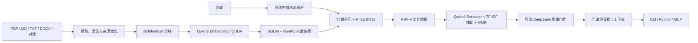

# Paper RAG：本地论文知识库

基于 **Qwen3 Embedding / Reranker、PyTorch、SQLite / NumPy 和 MCP** 的本地论文检索项目。支持 PDF、Markdown、TXT、DOCX 和调用方传入的对话，提供增量入库、混合检索、来源追溯、术语维护及可选的 DeepSeek 证据质量审查。

本仓库负责提供证据和上下文，回答生成交给连接它的助手。没有内置 Web 界面，也不包含论文数据、私人对话、模型权重或预建索引；首次使用需要安装依赖、下载模型并建立自己的知识库。

## 1. 包含哪些内容

```text
.
├── rag_library.py              # 建库、PDF 入库、检索、审计命令
├── rag_core/                   # 路径配置、编码器、SQLite / NumPy 存储、API 用量
├── ingestion/                  # PDF / 文本预处理、分块、并行建库和来源审计
├── retrieval/                  # 向量 + BM25 召回、RRF、重排、MMR、质量门控
├── knowledge/                  # MCP 服务、异步入库队列、目录监听、Windows 启动脚本
├── terminology/                # 缩写提取、候选/核验/生效表、TF-IDF、语义核验
├── config/                     # 检索、质量门控、自动维护和 MCP 示例配置
├── scripts/                    # 模型下载、环境检查、合成 PDF 示例
├── tests/                      # 可复用回归测试和 MCP 协议测试
├── .github/workflows/check.yml # Windows / Linux 的自动检查
├── requirements.txt            # 基础依赖，包含 MCP
├── requirements-npu.txt         # 可选 Intel NPU / OpenVINO 依赖
└── README.md                   # 统一使用文档
```

运行后会在数据工作区生成 `RAG/`，该目录已加入 `.gitignore`：

| 路径 | 用途 |
| --- | --- |
| `RAG/models/`、`RAG/model_cache/` | 官方权重、可选 NPU 导出图及编译缓存 |
| `RAG/PDF/`、`RAG/metadata/` | 归档文件及来源、SHA256 等元数据 |
| `RAG/inbox/` | MCP 后台监听的文件投递目录 |
| `RAG/阅读摘录/`、`RAG/knowledge_sources/` | 文本入库中间材料、对话角色和来源信息 |
| `RAG/library/` | 主数据库、向量快照、预处理审计、任务状态和日志 |
| `RAG/library/keyword_index/` | 可重建的 FTS5 / BM25 搜索副本 |
| `RAG/terminology/auto/` | 术语三表、全库统计和语义核验进度 |

## 2. 使用什么实现



- **预处理**：PyMuPDF 提取 PDF 文字和页码/坐标，规则处理双栏、断词与章节；python-docx 读取 DOCX。没有 OCR，扫描版 PDF 需要先在外部转成可提取文本。
- **分块与向量**：Qwen tokenizer 计数，默认目标 384、硬上限 512、重叠上限 64 token；Qwen3-Embedding-0.6B 采用 last-token pooling 与 L2 归一化，输出 1024 维向量。建库使用 PyTorch CUDA。
- **存储**：SQLite 保存文档与片段，NumPy 内存映射快照做精确余弦检索；按文档事务更新，完成后原子发布快照。没有独立向量数据库服务。
- **检索**：默认向量与关键词各召回最多 200 条，RRF 合并后每文档最多保留 8 条；前 40 条交给 Qwen3-Reranker-0.6B，再用 MMR 调整多样性，默认返回 5 条。生效术语和 TF-IDF 可辅助检索，缺少术语资源时沿用原查询。
- **质量门控**：DeepSeek 检查证据相关性、适用条件、覆盖范围和冲突；本地校验输出结构及逐字引用。它提供回答许可与证据范围，不直接生成答案。
- **MCP**：官方 Python MCP SDK，支持本机 Streamable HTTP 和 STDIO，复用检索服务与串行入库队列。
- **可选 NPU**：OpenVINO 静态图负责短查询 embedding；128 token 档常驻，256/512/1024 档最多额外驻留一个。NPU 缺失或故障时回退 CUDA，超过 1024 token 直接使用 CUDA。

## 3. 环境如何构建

### 环境要求

- Python **3.11**、64 位。依赖版本来自本项目的本地开发环境。
- 实际建库、重排和无 NPU 的查询需要 **NVIDIA GPU、驱动及 CUDA 版 PyTorch**。CPU 环境可以运行不依赖模型的回归测试，当前完整流水线没有 CPU 推理模式。
- Windows 是原始运行平台；代码同时提供 POSIX 写锁和基于 watchdog 的非 Windows 目录监听，并配置 Windows / Linux CI。实际 GPU/NPU 驱动仍需在目标机器验证。
- Intel NPU 为可选项。两份 0.6B 权重合计约数 GB，另需索引、缓存和原文空间；显存需求随批大小与输入长度变化。

下载 GitHub 仓库或 ZIP，进入含 `rag_library.py` 的目录。以下所有命令均在此目录执行；目录名可以自行修改。

Windows PowerShell：

```powershell
python -m venv .venv
.\.venv\Scripts\Activate.ps1
python -m pip install --upgrade pip
# 此环境使用 cu126 轮子；请确保 NVIDIA 驱动兼容。
python -m pip install torch==2.12.0 --index-url https://download.pytorch.org/whl/cu126
python -m pip install -r requirements.txt
python scripts/check_environment.py --require-cuda
```

若 PowerShell 不允许激活脚本，可将命令中的 `python` 替换成 `.\.venv\Scripts\python.exe`。

Linux / Bash：

```bash
python3.11 -m venv .venv
source .venv/bin/activate
python -m pip install --upgrade pip
python -m pip install torch==2.12.0 --index-url https://download.pytorch.org/whl/cu126
python -m pip install -r requirements.txt
python scripts/check_environment.py --require-cuda
```

`requirements-mcp.txt` 是旧命令的兼容入口，现在统一包含于 `requirements.txt`。NPU 依赖另见第 8 节。

### 下载模型

```bash
# 只显示计划，不下载
python scripts/download_models.py --dry-run
# 下载 embedding 与 reranker
python scripts/download_models.py
python scripts/check_environment.py --require-cuda --require-models
```

下载脚本通过 huggingface_hub 获取官方仓库的固定提交，写入本地 SHA256 清单 `provenance.json`。首次下载需访问 Hugging Face，之后模型推理只读取本地文件。`--model embedding` / `--model reranker` 可单独下载，`--local-files-only` 可仅使用已有缓存。

| 模型 | 固定 revision |
| --- | --- |
| `Qwen/Qwen3-Embedding-0.6B` | `97b0c614be4d77ee51c0cef4e5f07c00f9eb65b3` |
| `Qwen/Qwen3-Reranker-0.6B` | `e61197ed45024b0ed8a2d74b80b4d909f1255473` |

如需离线部署，在可联网机器下载后复制整个 `RAG/models/`。不要混用不同 embedding 权重建立和查询同一索引。

## 4. 命令如何运行：首次使用

### 不使用外部 API 的演示

先生成仓库自带的合成示例 PDF，再入库和检索。示例文字只用于软件验证，不是研究证据。此流程不需要 DeepSeek 密钥；请在未设置该密钥的终端运行。

```bash
python scripts/create_demo.py
python rag_library.py ingest --pdf RAG/inbox/demo.pdf --workers 1 --max-batch-size 4
python rag_library.py status
python rag_library.py search --query "How are passages traced back to the source document?" --no-quality-gate
```

入库时会保留归档副本；命令行手动入库不会自动删除 `inbox/demo.pdf`。演示确认后可自行删除投递副本。

### 使用自己的论文

```bash
# 指定 PDF，复制归档后增量入库；路径含空格时加引号
python rag_library.py ingest --pdf "/absolute/path/paper.pdf" --title "Paper title" --workers 1 --max-batch-size 4
# 或直接把可提取文字的 PDF 放入 RAG/PDF/ 后批量建库
python rag_library.py build --workers 1 --max-batch-size 4
# 无变化的文档复用已有结果；失败项可显式重试
python rag_library.py build --retry-failed
python rag_library.py status
python rag_library.py audit
```

先用较小批大小验证自己的硬件，再提高 `--max-batch-size`。只有 `indexed` 或指向已索引文档的去重条目才代表入库成功；`failed` / `quarantined` 需要检查 `RAG/library/processed/` 的报告。

默认数据工作区为仓库目录。可使用环境变量 `RAG_WORKSPACE`，或给入口传入 `--root`，让数据放在其他位置。**全局参数放在子命令前面**：

```bash
python rag_library.py --root "/absolute/path/workspace" build
python -m retrieval.cli --root "/absolute/path/workspace" search --query "your question" --no-quality-gate
python -m knowledge.mcp_server --root "/absolute/path/workspace"
```

配置优先从工作区 `config/` 读取，兼容旧版工作区的 `RAG_code/config/`，缺失时使用当前源码内的 `config/`。配置中的数据路径相对工作区解析。复用旧的“`RAG_code` 与 `RAG` 同级”布局时，传入两者的父目录即可，无需移动原数据。

## 5. 质量门控与配置

`config/retrieval.json` 配置模型路径、召回/重排参数及 DeepSeek 的 `base_url`、`model`、`api_key_env`、超时和输出上限。默认保留本地项目使用的 `deepseek-flash` 模型名；运行前应改成自己账号可用的模型标识。密钥只从环境变量读取，`.env.example` 仅作参考，程序不会自动加载 `.env`。

PowerShell 设置当前终端环境：

```powershell
$env:DEEPSEEK_API_KEY = 'your-api-key'
python rag_library.py search --query "论文的方法有哪些适用条件？"
```

Bash：

```bash
export DEEPSEEK_API_KEY='your-api-key'
python rag_library.py search --query "What conditions does the method require?"
```

查询默认开启门控，缺少密钥会明确报错；`--no-quality-gate` 显式关闭，结果标记为 `not_requested`，不表示证据已通过语义审查。`--no-rerank` 可关闭神经重排，便于对照。

| 文件 | 作用 |
| --- | --- |
| `config/retrieval.json` | 模型位置、200 路召回、40 条重排、MMR、术语和 API 参数 |
| `config/quality_gate_policy.json` | 门控首批 16、最多 30 条候选、轮次、超时与预算 |
| `config/quality_gate_rubric.md` | 程序运行时读取的门控提示词，必须保留 |
| `config/knowledge_automation.json` | 启用目录监听、稳定等待时间与术语维护路径 |
| `config/terminology_verification.json` | 外部术语审查批量、并发和自动发布开关 |
| `config/term_scope_cues.json` | 缩写展开时用于判断语境的领域提示 |

**外部调用的数据与费用**：开启查询门控后，问题和候选原文片段会发给配置的 DeepSeek 服务。术语语义核验默认启用，配置密钥后，建库完成或 MCP 后台维护也可能提交缩写、全称与定义原文；仅需本地处理时将 `terminology_verification.json` 的 `enabled` 设为 `false`。缺少密钥时语义核验等待配置，不会伪造批准结果。

已校验的审查可缓存复用；用量保存在 `RAG/library/api_accounting.sqlite3`，本地 tokenizer 对外部模型的 token 估计仅为近似，实际用量以服务返回为准。更改模型、预处理代码或分块参数后，旧库会拒绝混入不同版本向量，请使用新的 `--index-dir` 重建。

## 6. MCP 与其他调用方式

### 启动服务

先完成模型下载和至少一次成功建库，再启动：

```bash
python -m knowledge.mcp_server --list-tools
python -m knowledge.mcp_server
```

默认监听 `http://127.0.0.1:8765/mcp`，供本机 MCP 客户端连接。HTTP 与 STDIO 两种模式二选一；同一索引使用一个服务实例。当前实现面向本机使用，未提供公网鉴权部署。

支持 URL 连接的客户端填写上述地址。TOML 示例在 `config/codex-mcp.example.toml`，也可以配置 STDIO；将以下路径替换为实际绝对路径：

```toml
[mcp_servers.local_knowledge]
command = '/absolute/path/paper-rag/.venv/bin/python'
args = ['-m', 'knowledge.mcp_server', '--transport', 'stdio']
cwd = '/absolute/path/paper-rag'
env_vars = ['DEEPSEEK_API_KEY']
startup_timeout_sec = 120
tool_timeout_sec = 300
```

Windows 将 `command` 改为虚拟环境的 `Scripts/python.exe`。客户端应遵循 `quality_gate.answer_allowed` 与 `answer_scope`，证据不足时说明缺口。

| 工具 | 用途 / 主要参数 |
| --- | --- |
| `paper_search` | 检索：`query`、`top_k`、`doc_ids`、`quality_gate`、`term_scopes` |
| `paper_get_chunk` | 来源片段：`doc_id`、`chunk_id` |
| `paper_read` | 顺序读取已索引文本：`doc_id`，可选页码、章节、offset / limit |
| `paper_retrieval_status` | 查看索引、路由、任务、术语核验和 API 用量 |
| `paper_ingest` | PDF 入库：`path`、可选 `title` |
| `document_ingest` | MD/TXT/DOCX 或文本：`title`，`path` / `content` 二选一 |
| `conversation_save` | 保存调用方提供的 `messages` 与角色，可选 `conversation_id` |
| `ingest_job_status` | 用返回的 `job_id` 查询，只有 `completed` 表示本次成功 |

入库工具接收本地路径，不提供 URL 下载。默认只能读取工作区内文件；通过可重复的 `--allow-read-root "/absolute/path/papers"` 扩展读取目录。单文件上限 100 MiB，文本/对话上限 100 万字符，文本要求 UTF-8，不支持旧版 DOC。`paper_read` 只读已索引片段，可能存在块间重叠，不等于还原完整 PDF 图表版式，也不执行质量门控。

服务启动后自动监听 `RAG/inbox/` 和 `RAG/PDF/`：稳定 20 秒后提交新文件，成功且哈希匹配后处理投递副本；失败文件保留。术语统计在队列排空、变化合并 30 秒后更新。`knowledge_automation.json` 的 `enabled=false` 可关闭后台维护。入库与推理使用串行资源策略，外部手动建库请先停止服务。

### JSONL / Python

```bash
python -m retrieval.cli tools
python -m retrieval.cli search --query "your question" --no-quality-gate
python -m retrieval.cli serve
```

`serve` 为 JSONL 调试协议，每行输入一条请求，不是 MCP 传输：

```json
{"id":1,"name":"paper_search","arguments":{"query":"your question","quality_gate":false}}
```

在仓库目录运行 Python，长期应用复用同一个实例：

```python
from rag_core.config import default_root
from retrieval.query import PaperRetriever

with PaperRetriever(default_root()) as retriever:
    result = retriever.search("your question", top_k=5, quality_gate=False)
    print(result)
```

## 7. 术语维护和恢复

Schwartz–Hearst 规则从已入库原文提取缩写—全称候选，候选、核验、生效关系分表保存。只有通过来源检查和核验的生效关系参与展开；歧义缩写需要领域或指定文档证据。词频、DF、IDF、TF-IDF 基于文档正文统计，避免把重叠块重复计数。

后台任务或独立建库会触发增量维护。查看 `RAG/terminology/auto/current.json`、`verification_status.json` 和 `人工复核预览.md`；账户或配置恢复后可显式续跑：

```bash
python -m terminology.semantic_review --resume-account
# 只用已缓存审查发布，不发出新的模型请求
python -m terminology.semantic_review --publish-cached
# 离线用量对照：需要已有的 semantic_audit.sqlite3
python -m terminology.token_budget
```

论文入库成功与术语审查完成是两个独立状态。对话仅保存调用方明确传入的消息，不会自动读取聊天历史；个人讨论来源也不会作为论文原文引用。

## 8. 可选：Intel NPU 与 Windows 登录启动

不使用 NPU 时跳过本节的模型导出，查询会自动回退 CUDA。需要 NPU 时先安装对应 Intel NPU 驱动，然后：

```bash
python -m pip install -r requirements-npu.txt
python -m retrieval.prepare_npu_model --sequence-length 128
python -m retrieval.prepare_npu_model --sequence-length 256
python -m retrieval.prepare_npu_model --sequence-length 512
python -m retrieval.prepare_npu_model --sequence-length 1024
```

导出使用本地同一份 embedding 权重，静态 batch=1、FP16 存储；推理不会临时编译缺失的导出文件。OpenVINO / NPU 导出不属于基础复用流程，兼容性取决于目标驱动。

Windows 用户可用任务计划程序登录后启动服务，先在已激活虚拟环境的 PowerShell 执行：

```powershell
# 可选：隐藏输入后保存为 Windows 用户环境变量
.\knowledge\configure_api_key.ps1
# 只生成当前机器的任务 XML
.\knowledge\register_autostart.ps1 -Preview
# 注册并启动当前用户任务 LocalKnowledgeMCP
.\knowledge\register_autostart.ps1
```

脚本从当前 `python` 解析解释器，默认工作区为仓库目录；可用 `-PythonPath` / `-WorkspaceRoot` 覆盖。生成的 `autostart-task.xml` 不应提交。服务日志位于 `RAG/library/service_logs/`。停止/重启前确认已接受的入库任务完成：

```powershell
Stop-ScheduledTask -TaskName LocalKnowledgeMCP
Start-ScheduledTask -TaskName LocalKnowledgeMCP
```

## 9. 验证、常见问题与发布

```bash
python scripts/check_environment.py
python -m unittest discover -s tests -t . -v
python -m knowledge.mcp_server --list-tools
```

测试使用临时数据、假编码器与模拟 HTTP 响应，不需要论文、模型权重或 API 密钥；涉及真实 tokenizer 的两组集成测试在缺少模型时会跳过。GitHub Actions 配置在 Windows / Linux 上安装 CPU PyTorch 并运行同一套检查，不代表已验证目标机器的 CUDA / NPU 推理。

| 现象 | 处理 |
| --- | --- |
| `CUDA 不可用` | 检查驱动与 PyTorch CUDA 轮子，运行环境检查的 `--require-cuda` |
| 找不到本地模型 | 运行 `scripts/download_models.py`，确认建库、查询使用相同 `--root` |
| 索引不存在 / 没有快照 | 先成功入库一份可提取正文的 PDF，再启动查询或 MCP |
| 缺少 DeepSeek 密钥 | 配置环境变量，或查询时明确加 `--no-quality-gate` |
| 显存不足 | 降低 `--max-batch-size`、重排批量和输入长度，停止其他占用 GPU 的进程 |
| 旧库提示签名不一致 | 使用新的 `--index-dir` 建库，避免混用权重或处理版本 |
| 入库返回 queued / running | 使用 `ingest_job_status` 等待完成，检查失败日志 |
| 术语核验等待账户或配置 | 修复账户/模型配置，再用 `--resume-account` 继续 |

发布时以本目录作为 GitHub 仓库根目录，所有使用说明集中在本 README。`.gitignore` 排除本地数据、密钥、权重、数据库、IDE 缓存与运行结果。提交前用 `git status --short` 检查文件；本项目没有自动推送 GitHub 的脚本。

代码采用 [MIT License](LICENSE)。下载的模型和自行导入的论文/材料分别遵循其原始许可。
